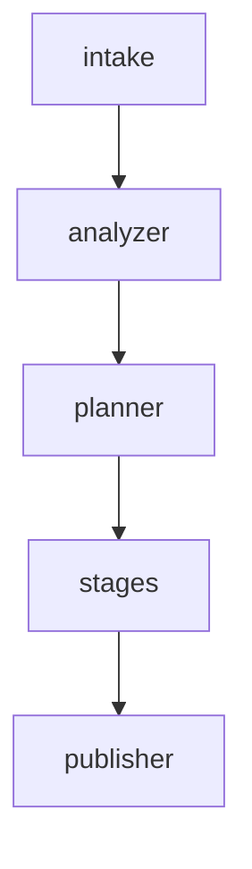
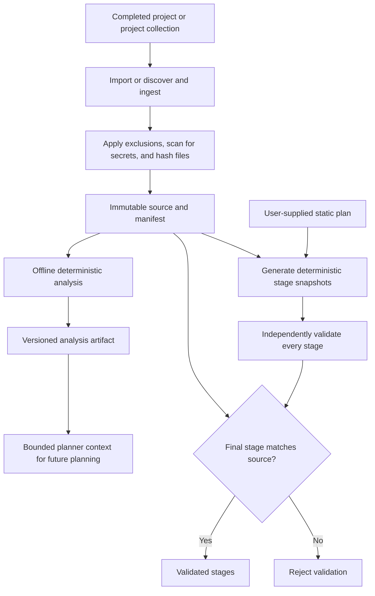
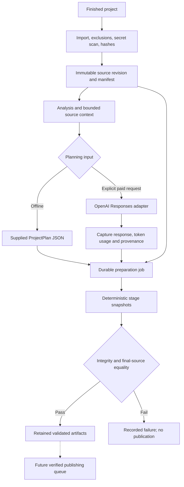
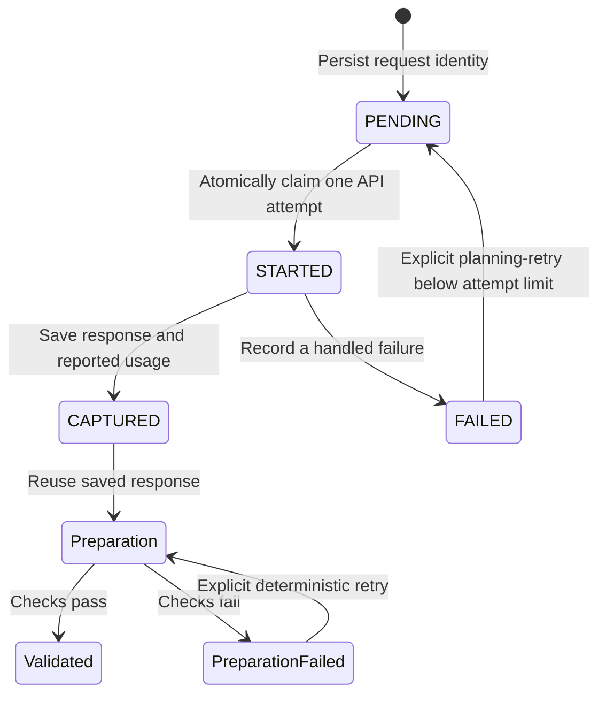
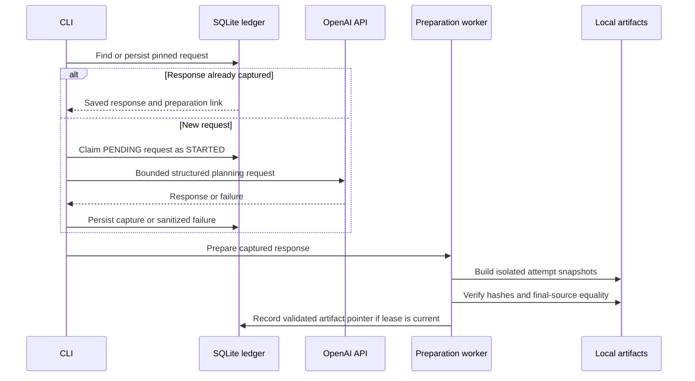
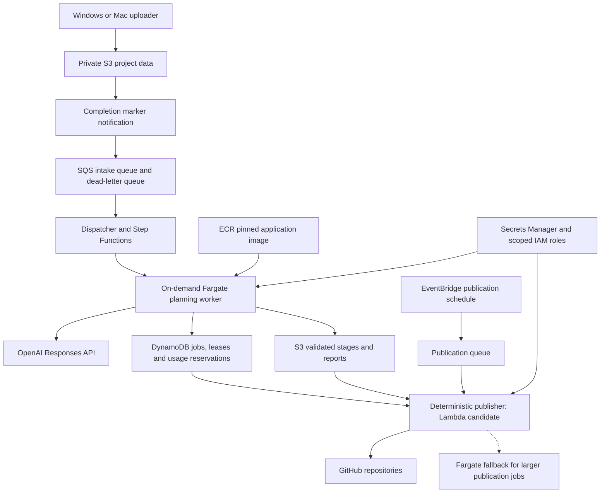
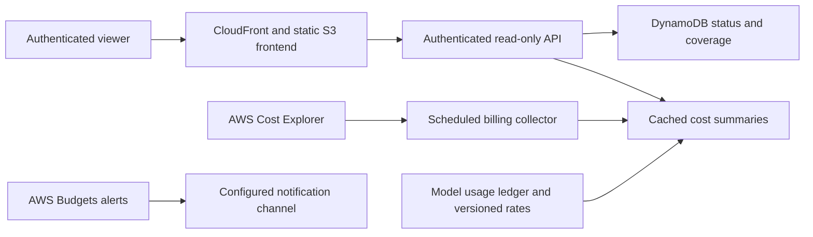

# Git Progressor

Git Progressor turns a completed software project into a reviewable sequence of logical
development stages and, in later milestones, publishes approved stages on a schedule. Its
central rule is simple: AI may suggest a plan, but deterministic Python reconstructs it,
and the final reconstructed tree must exactly match the imported project.

This repository currently implements deterministic stage generation and independent
final-state validation. It does **not** call OpenAI, commit, or push to GitHub.

## Requirements

- Python 3.11 or newer
- A local filesystem suitable for SQLite

## Install for development

```bash
python -m venv .venv
.venv/Scripts/activate       # Windows PowerShell
python -m pip install -e ".[dev]"
pytest
```

On Linux, activate with `source .venv/bin/activate`.

Copy `.env.example` to `.env` when custom paths are needed. Do not place API keys or Git
credentials in that file if it could enter version control.

## Current workflow
Stage Progression


Deterministic Progression


Live AI planning, execution scheduling, and publication are future milestones. Analysis does not
yet generate the static plan used for stage generation.

Import a completed project:

```bash
git-progressor import ./my-project
```

The command validates the directory, applies built-in exclusions and its `.gitignore`,
rejects symlinks and likely credentials, hashes every included file, copies it into a new
project directory, verifies the copy, writes `manifest.json`, and records the project in
SQLite. It prints the new project UUID on success.

Discover and ingest a collection of independent projects:

```bash
git-progressor ingest C:\Users\pilot\projects
```

`ingest` finds conservative project boundaries, imports new logical projects, recognizes
known revisions and moved or duplicated copies, and stores changed content as a new
immutable source revision. A failure in one candidate does not roll back other successful
imports; the command reports every outcome and exits non-zero when any candidate fails.

`sync` is intentionally not present yet. Its future meaning is reserved for actively
reconciling new revisions of known projects.

List imported projects:

```bash
git-progressor status
```

Status includes a publication bar for the latest plan once all stages are validated, for example
`[############--------]  60%  3/5 stages published`. Only publication jobs marked
`PUBLISHED` with a recorded commit SHA count toward progress. Projects without a plan
show `Awaiting plan`; unvalidated plans show `Awaiting automated validation`. No human
approval is required. Publication remains a future milestone.

Analyze the latest immutable source revision, or select an exact revision:

```bash
git-progressor analyze PROJECT_ID
git-progressor analyze PROJECT_ID --revision SOURCE_TREE_HASH
```

Analysis is deterministic, offline, and metadata-only. It records languages, declared
dependencies, evidenced frameworks/tools, tests, configuration, infrastructure,
documentation, entrypoints, lightweight modules, selected important paths, statistics,
and explicit truncation warnings. It never executes project code or includes source text.

Generate snapshots from a static, strictly validated plan:

```bash
git-progressor generate PROJECT_ID --plan ./stage-plan.json
```

The plan is persisted at `planning/plan.json`. Later idempotent runs can omit `--plan`:

```bash
git-progressor generate PROJECT_ID
git-progressor validate PROJECT_ID
```

Each operation is `add`, `modify`, or `delete`. Added and modified bytes come either from
base64 embedded in the plan or a safe relative `source_path` in the immutable source.
Generation never executes plan content. A stage is built under a unique `.tmp-*` directory,
hashed, atomically renamed, and recorded in SQLite.

Validation rescans every snapshot without trusting the generator or stored hashes. It
rejects structural gaps, unexpected stages, symlinks, ignored metadata, credentials, and
manifest mismatches. It then compares the final snapshot with the independently rescanned
source by both individual path/hash entries and aggregate tree hash. Invalid results return
a non-zero exit code and never display file contents.

The following command remains deliberately inert. It returns exit code 2 and performs no
Git operation:

```bash
git-progressor publish PROJECT_ID --dry-run
git-progressor publish PROJECT_ID
```

## Intended workflow

```bash
git-progressor import PATH
git-progressor analyze PROJECT_ID
git-progressor plan PROJECT_ID
git-progressor show-plan PROJECT_ID
git-progressor generate PROJECT_ID
git-progressor validate PROJECT_ID
git-progressor schedule PROJECT_ID
git-progressor publish PROJECT_ID --dry-run
git-progressor publish PROJECT_ID
```

Live AI planning, execution scheduling, and publication remain future milestones.

## Offline planner interface

The provider-neutral planner receives a typed request with verified revision identity,
analysis, the file inventory, and bounded UTF-8 source text (64 KiB per file, 256 KiB total).
Binary and oversized files are explicitly listed as omitted; they remain available through
declarative source references during reconstruction. Source text is intentionally separate
from the analyzer's metadata-only context. No request is sent over the network yet.

Test an existing provider response against the calculator source:

```bash
git-progressor import tests/fixtures/calculator-final
git-progressor plan PROJECT_ID --response tests/fixtures/calculator-plan.json --output data/calculator-proposal.json
```

`--revision SOURCE_HASH` selects an exact imported revision; otherwise the latest is used.
This offline adapter reads a supplied plan, not an AI-generated new plan. The service rejects
malformed responses, excessive stage counts, unsafe stages, empty changes, and a final tree
that differs from the selected source. It reconstructs stages in temporary storage without
executing their code. Temporary storage is isolation from project artifacts, not an OS sandbox.
Runtime checks and semantic accuracy of commit messages still require review.

The saved proposal includes project/revision/analysis/plan hashes and stage hashes. It is
marked `VALIDATED` under `automatic-integrity-v1`, with `human_approval_required: false`.
No human gate remains. Failed checks reject the plan; optional inspection is still available.
It never overwrites an existing output and does not yet enqueue or publish anything.
Its `plan` field contains the existing `ProjectPlan` format; the proposal
envelope itself is not input to `generate`. Existing generated snapshots are left untouched.

## Reviewing incomplete stages

Intermediate stages may be incomplete or non-runnable. Commit messages should describe
actual changes without claiming unfinished functionality works. Review the saved proposal:

```bash
git-progressor show-plan PROJECT_ID
git-progressor validate PROJECT_ID --python-syntax
```

The optional Python syntax check uses the interpreter running Git Progressor. Intermediate
syntax failures produce `REVIEW` warnings; final-stage syntax failures reject validation.
It compiles in memory without executing project code or writing bytecode. It does not
check imports, run tests, or prove that the application works. Other languages and runtime
test execution remain future work. Integrity, secret, and final-state equality checks
always block invalid output, regardless of the syntax option.

The calculator fixture demonstrates intentionally incomplete package exports in early
stages. Its plan descriptions explain those limits. You can import
`tests/fixtures/calculator-final`, generate with `tests/fixtures/calculator-plan.json`, then
use the review and validation commands above. Updated plan text changes its hash: use a
fresh import for this example rather than replacing a plan behind existing snapshots.

## Data layout

```text
data/
├── git-progressor.db
└── projects/
    └── <uuid>/
        ├── manifest.json
        ├── source/
        ├── planning/
        ├── analyses/
        │   └── <source-tree-hash>/analyzer-v1/project-analysis.json
        ├── revisions/
        │   └── <source-tree-hash>/
        │       ├── manifest.json
        │       └── source/
        ├── stages/
        │   ├── 001/
        │   ├── 001.manifest.json
        │   └── ...
        └── state/
```

The source tree is authoritative. Import never mutates the input and never overwrites an
existing project directory. See [architecture](docs/architecture.md),
[security](docs/security.md), and [project format](docs/project-format.md).

## Security assumptions

The built-in scanner catches common credential filenames, private-key headers, AWS access
key IDs, and GitHub token formats. It is deliberately a first barrier, not a guarantee.
Later publication must rescan each exact stage with a mature scanner, keep SSH keys outside
project storage, retrieve secrets through AWS Secrets Manager or SSM, redact logs, and run
under a dedicated least-privileged account.

## Tree hashing

Every file is hashed with SHA-256 over its bytes. The tree hash feeds a second SHA-256 with
each file in sorted POSIX-path order as `path`, a NUL byte, the binary file digest, and a
final NUL byte. Timestamps, permissions, ownership, and directory entries are excluded.
A one-byte content change therefore changes both the file hash and tree hash.

## Project identity and revisions

The internal UUID identifies a logical project. A deterministic `source_identity` finds
that project again without using its absolute path. Where possible it hashes the marker
type and declared project name from bounded `pyproject.toml`, `package.json`, `Cargo.toml`,
`setup.cfg`, or `go.mod` metadata. Otherwise it hashes the normalized directory name and
marker set. The separate source tree hash identifies one exact content revision.

Exact revisions are recognized after moves and across duplicate copies. Changed content at
the last known location becomes a new revision. Declared identities also survive a move and
change together. A structural identity seen at a new path with different content is
reported as a conflict because the match is ambiguous.

## Analysis limits and planner context

The analyzer uses configurable file-count, per-metadata-file, cumulative metadata-byte,
and important-file limits. All ordering is canonical, and truncation is always reported.
`analysis_hash` is SHA-256 over canonical compact JSON excluding the hash field itself.

`PlannerContextBuilder` derives a smaller typed payload solely from the saved analysis. It
contains safe classifications and paths, not excerpts or raw repository contents. A future
planner can therefore consume bounded context without direct repository access.

## Roadmap

The [OpenAI planner adapter](docs/openai-planner.md) now has bounded structured
requests and fake-client tests. `prepare-openai` connects captured model responses
to durable jobs; `planning-status` and `planning-resume` inspect and recover them.
Live API verification remains pending. Offline commands never call a model.

The [durable preparation worker](docs/preparation-worker.md) now saves offline
preparation jobs and their validated stage snapshots. Use `prepare PROJECT_ID
--response PLAN.json`, `preparation-status JOB_ID`, and `prepare-resume JOB_ID`
to run, inspect, and recover work. This is single-host processing; it makes no AI
requests or Git pushes and is not yet connected to AWS or the publication queue.

The [cloud roadmap](docs/cloud-roadmap.md) describes local preparation, S3 handoff,
unattended publication, and the implementation gaps. A local `schedule-preview` command
now saves reproducible draft evening schedules and coverage forecasts; it does not approve
or publish work. See the roadmap for its queue format and command example.

1. Extract artifact and state-store ports for local and future AWS adapters.
2. Bind automatic validation evidence to immutable artifacts and connect validated plans to jobs.
3. Integrate the Responses API with strict structured output and redacted inputs.
4. Add publication manifests, scheduling, locking, and guarded Git publication.

---

## Milestone addendum — November 1, 2026

This section is appended to preserve the earlier README specifications for later
editing. It describes the current implementation and supersedes older statements
above that the application cannot call OpenAI or that every planning component is
still a placeholder. Earlier examples remain useful, but the commands below
describe the new durable preparation workflow.

### What the project accomplishes today

Git Progressor accepts a finished project as the source of truth. It can take a
supplied development plan, or explicitly request one through OpenAI, reconstruct
its stages, and check that the final stage contains the original included files
with identical bytes. Intermediate stages may be unfinished. Commit messages
should explain the actual changes without claiming that unfinished features work.

The planner proposes changes; ordinary Python applies and verifies them. There is
no human approval gate. Automated validation is mandatory, while inspection is
optional. Passing integrity validation does not prove that intermediate code runs
or that every explanation is semantically accurate.

| Component | Current state | Important boundary |
| --- | --- | --- |
| Intake and revisions | Implemented locally | Exclusions, credential heuristics, immutable source copies and hashes |
| Deterministic analysis | Implemented | Bounded metadata analysis; no project execution |
| Offline planning | Implemented | Reads a supplied response rather than inventing one |
| OpenAI adapter | Implemented and tested with simulated responses | Actual generation has not yet succeeded in the live trial |
| Durable preparation | Implemented with SQLite and local files | One host; not a distributed AWS worker yet |
| Stage validation | Implemented | Final-source equality and security checks block invalid plans |
| Model request recovery | Implemented | Captured responses are reused; uncertain requests are not automatically repeated |
| Draft scheduling | Implemented locally | A forecast, not an executable publishing queue |
| Git publication | Not implemented | `publish` remains inert; no application-driven commits or pushes |
| AWS infrastructure | Foundation code and design documentation | No resources deployed during this session |
| Dashboard and cost reporting | Planned | No running website or billing collector yet |

### Current local processing flow



The API receives bounded context and selected source excerpts, not unrestricted
filesystem access. Binary and omitted files remain addressable through source
references. Generated file changes are declarative add/modify/delete operations;
the model is not given shell execution tools.

### What was added in this session

1. A persistent preparation job store with pinned source revisions, captured
   offline response bytes, attempt counts, and worker leases.
2. Retained source manifests, proposals, stage snapshots, and an aggregate artifact
   digest, rather than discarding all generated stages after proposal validation.
3. A bounded Responses API adapter with strict structured output, local schema
   validation, input/output limits, explicit model selection, and no SDK retries.
4. A model-request ledger that saves responses before deterministic preparation,
   records reported token usage, and links requests to preparation jobs.
5. Recovery commands that reuse saved work without contacting the model again.
6. An explicit failed-request retry command, capped at three total API attempts,
   with historical failure and usage evidence retained.
7. Sanitized provider error categories for authentication, permissions, model lookup,
   bad requests, rate/quota limits, server failures, connection failures and timeouts.
8. Offline tests covering replay, corrupt artifacts, concurrent claims, interrupted
   work, response reuse, malformed output, and bounded retries.

The complete suite passed **101 tests** before this documentation addendum, and
lint passed for changed Python files. These results establish the tested local
behavior; they are not evidence of a successful production cloud deployment.

### OpenAI request lifecycle and retry boundaries



A process that stops during an API attempt can leave a request in STARTED. That
state is deliberately not auto-reset: the provider may have received and charged
for the call even though no response was saved locally. Explicit API retry also
refuses STARTED requests. Reconciliation for those uncertain outcomes is future work.

CAPTURED means a response is saved, not that its stages have passed validation.
Preparation can fail after capture; its retry reuses the saved response. Repeating
an identical successful request verifies existing artifacts rather than generating
another response. Changing the project, context, model or policy can create a new
request identity and therefore another potentially billable call.



### Preparation leases and files

Preparation jobs move through PENDING, RUNNING, SUCCEEDED, or FAILED. An atomic
SQLite update gives one worker a 15-minute lease. Only the current, unexpired
owner can accept a result. An expired attempt may be reclaimed, with at most
three attempts. There is no heartbeat or automatic polling loop yet.

Each attempt has a separate output directory. A crash before the success record
leaves an unreferenced directory; a retry rebuilds elsewhere. A crash after the
record commits is handled by checking and reusing the recorded output. Missing
or changed completed artifacts are rejected, not silently repaired.

```text
data/
├── git-progressor.db
├── projects/<project-id>/
│   ├── source/
│   ├── manifest.json
│   └── revisions/...
└── preparations/<job-id>/<attempt-owner>/
    ├── response.json
    ├── proposal.json
    ├── manifest.json
    ├── source/
    └── stages/
        ├── 001/
        ├── 001.manifest.json
        └── ...
```

The SQLite artifact pointer marks accepted output. Filesystem storage and the
database are trusted local boundaries; the hashes are not signatures. Failed and
abandoned attempt directories are retained. Cleanup policies and storage quotas
remain future work. These jobs do not yet populate the legacy publication tables
or turn the existing publication progress bar into a live publishing report.

| Migration | Added state |
| --- | --- |
| 5 | `preparation_jobs`: source/response identity, lease, attempts, artifacts and failures |
| 6 | `planning_requests`: context/model/policy identity, response, usage and linked job |
| 7 | Model attempt counts and `planning_retry_history` for explicitly retried failures |

### WSL setup and commands

WSL is the current development and test environment. A Linux virtual environment
must be created separately from a Windows virtual environment. Existing users can
activate their `.venv-wsl`; new users can create it first:

```bash
python3 -m venv .venv-wsl
source .venv-wsl/bin/activate
python -m pip install -e '.[dev,openai]'
```

Load an API key only in the terminal that will execute live planning. The following
prompt hides the pasted value and avoids entering it directly into shell history:

```bash
read -rsp "OpenAI API key (hidden): " OPENAI_API_KEY
printf '\n'
export OPENAI_API_KEY
```

This environment variable is local to that terminal and its child processes. It
is not automatically available to a separate IDE or agent terminal. The SDK
factory reads it from the process environment; placing it only in `.env` does not
make it available to that factory. Never paste keys into issues, screenshots, chat,
Git commits, or source files.

| Command | Purpose | Can invoke a paid model request? |
| --- | --- | --- |
| `prepare PROJECT_ID --response PLAN.json` | Capture an offline response and retain validated stages | No |
| `preparation-status JOB_ID` | Inspect preparation status and attempts | No |
| `prepare-resume JOB_ID` | Resume pending/expired work or verify completed artifacts | No |
| `prepare-resume JOB_ID --retry` | Retry failed deterministic preparation | No |
| `prepare-openai PROJECT_ID --model MODEL` | Request a plan and connect capture to preparation | Yes, for a new request |
| `planning-status REQUEST_ID` | Inspect request status, usage and preparation link | No |
| `planning-resume REQUEST_ID` | Prepare an already captured response | No |
| `planning-resume REQUEST_ID --retry` | Retry failed preparation using captured data | No |
| `planning-retry REQUEST_ID` | Explicitly retry a FAILED API request | Yes, up to three total attempts |

Prefix each command with `git-progressor`. Import a project once and retain its
ID. Do not re-import simply to bypass a failed request; a new project identity can
trigger a separate paid call. For the calculator fixture:

```bash
git-progressor import tests/fixtures/calculator-final
# Substitute the printed project ID below.
git-progressor prepare PROJECT_ID --response tests/fixtures/calculator-plan.json
# Optional live test: substitute a supported, accessible model explicitly.
git-progressor prepare-openai PROJECT_ID --model MODEL
```

The adapter defaults to 8,192 output tokens and a 120-second timeout. Output tokens
are not commits or remaining account credits. Input tokens also incur charges;
byte/token limits are not a dollar spending cap. No automatic paid fallback exists.
See [OpenAI setup and recovery](docs/openai-planner.md) for configuration limits.

### Live trial result and present blocker

During the November 1 session, authentication and model metadata lookup succeeded
from the user's WSL terminal. The subsequent recorded planning retry returned a
rate-or-quota error. That category can indicate a rate limit, unavailable quota,
or billing/usage restrictions; it does not identify the exact cause by itself.
No successful live-generated calculator plan has been verified yet.

Two attempts were used for that trial request. No token usage was returned in its
saved record, which does not establish that no charge occurred. Before another
attempt, inspect API billing and limits and preserve the existing request identity.
The earlier attempt retained only a generic error; improved diagnostics cannot
retroactively recover discarded provider detail.

Repository commits made during development are separate from the application's
future Git publisher. Pushing this tool's source to GitHub does not mean scheduled
publication of user projects has been implemented.

### Planned AWS architecture — not deployed

The intended operational workflow is cloud-first: Windows/WSL and Mac computers
upload finished projects, and cloud workers prepare them while those computers
are offline. Local processing is currently how the logic is developed and tested,
not a requirement that every future project be preprocessed on a personal device.



Every AWS component in this diagram is a deployment target, not a running service
provided by the current application. Terraform currently contains a private S3
foundation and legacy EC2 role/profile; the broader serverless design is documented
in [the Terraform architecture plan](deployment/terraform/ARCHITECTURE.md).

- S3 stores uploaded source, pinned revisions, validated snapshots and reports.
  Prefixes organize data; IAM and bucket policies enforce access boundaries.
- ECR stores released application images. Uploaded project source must never be
  treated as the worker application itself or as a shell script to execute.
- SQS absorbs upload events and retries; duplicate events require stable identity
  and conditional job transitions.
- Fargate is planned for longer preparation work. Short publication tasks may fit
  Lambda; runtime, disk and repository-size measurements must validate that choice.
- DynamoDB replaces local SQLite for distributed jobs and leases. A live SQLite
  database must not be synchronized between workers through S3.
- EventBridge supplies schedule triggers. A trigger does not override stage order,
  validation, lease ownership or remote Git checks.
- Separate worker roles and managed secrets replace dependence on personal terminal
  credentials. Terraform state requires its own restricted backend design.

No always-on EC2 instance is required by the current target design. EC2 remains a
possible alternative after workload and cost measurement. Serverless is not assumed
to be universally cheaper; storage, requests, logs, networking and model calls must
all be included in deployment estimates.

### Future publication and coverage reporting

The local schedule preview chooses one to three meaningful stages per Tokyo day,
with distinct times from 8 PM through just before 11 PM. It preserves project and
stage order, using a saved seed for reproducibility. Its output is DRAFT and is not
authorization for a publisher to execute arbitrary input.

The future publisher should consume verified stage data, not AI-generated commands.
It will check the repository, remote, branch, clean worktree, expected parent,
credentials and stage integrity; then commit, push without force, and record the
result. Crash recovery must reconcile a remote push before making another commit.
Creating new repositories and authorizing a dedicated GitHub identity are still
implementation work.

Coverage reporting should show stages remaining, per-project completion dates and
aggregate backlog duration from the saved schedule. Failures and exhausted backlog
must be visible. Neither a schedule nor this application can guarantee a GitHub
contribution square every day.

### Planned dashboard and cost visibility



This dashboard is planned, not implemented. It should display completed work, next
stages, failures, backlog coverage, AWS spending and separately identified model
usage estimates. Billing data has latency and must show its freshness. AWS totals
must not be presented as total AWS-plus-OpenAI spending. Budget alerts are not an
instantaneous hard cutoff. The working budget target remains USD 100 per month,
with deployment costs and whether AI is included to be finalized before launch.

### Next implementation milestones

1. Resolve the live API rate/quota blocker and validate one real calculator plan.
2. Inspect actual stage changes and messages, then test a representative real project.
3. Add durable spending reservations, uncertain-call reconciliation, resource limits,
   artifact cleanup and renewable worker leases.
4. Define portable artifact/state adapters and implement private S3 upload plus
   cloud preparation deployment from pinned releases.
5. Implement GitHub repository provisioning and deterministic publication, including
   remote divergence checks and recovery after a successful push.
6. Connect validated database state to saved schedules and coverage forecasts.
7. Build the authenticated dashboard, alerts and cost reporting, then rehearse
   unattended operation and failures before relying on it while away.

Related references: [architecture](docs/architecture.md),
[preparation worker](docs/preparation-worker.md),
[OpenAI planner](docs/openai-planner.md),
[cloud roadmap](docs/cloud-roadmap.md), and
[Terraform design](deployment/terraform/ARCHITECTURE.md).
